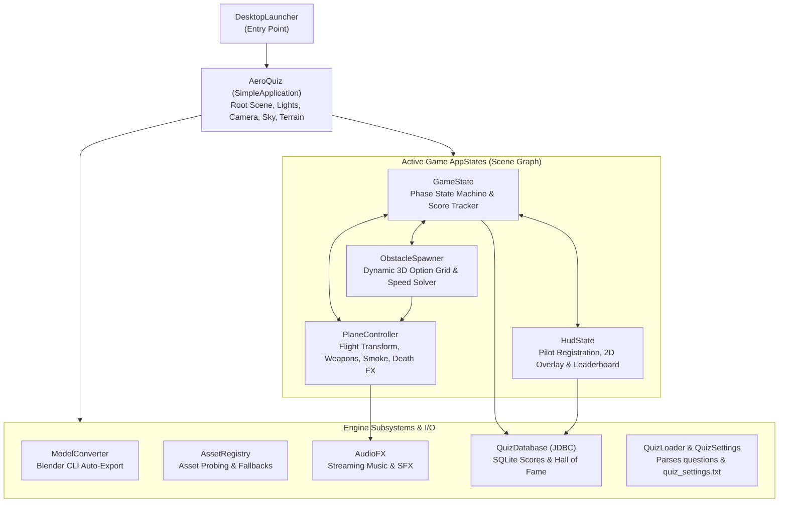
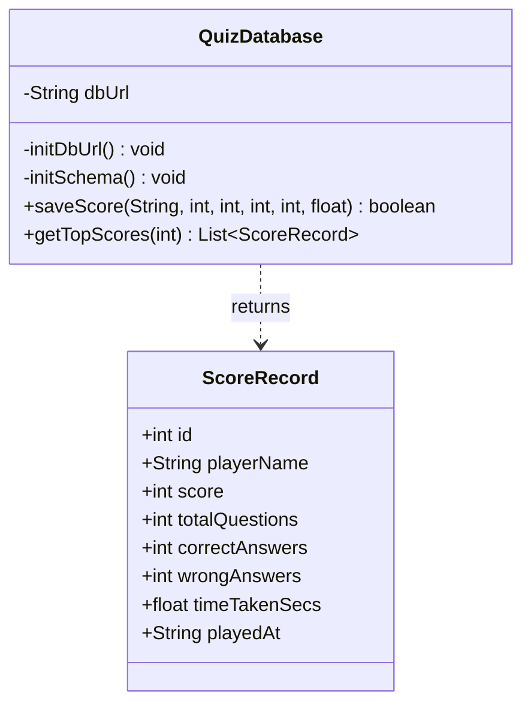

# AeroQuiz: Complete Codebase Architecture & Database Guide

AeroQuiz is a real-time 3D flight-simulator quiz game built on **Java 21/25** and the **jMonkeyEngine 3.9 (jME3)** framework. This document provides an exhaustive, source-level architectural breakdown of every module, subsystem, and source file in the repository, followed by a dedicated deep-dive into the database persistence layer implemented via **Java Database Connectivity (JDBC)** and **SQLite**.

---

## 1. System Architecture & Component Interaction

AeroQuiz adopts jMonkeyEngine's **AppState Design Pattern** (similar to the Entity-Component-System / MVC pattern). In this model, the main application orchestrates the window and scene root, while decoupled, modular `AppState` controllers manage discrete responsibilities (state machine, flight physics, dynamic obstacle rendering, 2D HUD UI, audio, and database operations).



---

## 2. Directory & Module Structure

The project is structured as a Gradle multi-project workspace:

```
AeroQuiz/
├── assets/                     # Runtime game assets (3D models, textures, audio)
│   ├── Models/                 # plane.glb, propeller.glb, obstacle.j3o
│   ├── Sounds/                 # bg_music.ogg, explosion_correct.wav, steam_hiss.wav
│   └── Textures/               # Sky cubemaps, Water, Sand, Snow, Grass textures
├── desktop/                    # Desktop launcher module (LWJGL3 / OpenGL desktop runner)
│   ├── build.gradle            # Packaging, distribution, and native runtime dependencies
│   └── src/main/java/.../DesktopLauncher.java
├── game/                       # Core cross-platform game logic & systems
│   ├── build.gradle            # Dependencies (jME3, SQLite JDBC, Lemur, Minie)
│   └── src/main/java/.../game/ # All game source files
├── questions.txt               # Quiz question catalog (with syntax for answers & options)
├── quiz_settings.txt           # Live gameplay settings (lives, timer, terrain)
└── aeroquiz.db                 # SQLite embedded database file (auto-generated)
```

---

## 3. Detailed Source File Breakdown

Every Java source file in [`game/src/main/java/com/daddydaiwik/aeroquiz/game/`](file:///home/droy/Development/Java/AeroQuiz/AeroQuiz/game/src/main/java/com/daddydaiwik/aeroquiz/game/) has a well-defined single responsibility:

### 3.1. Entry Point: [`DesktopLauncher.java`](file:///home/droy/Development/Java/AeroQuiz/AeroQuiz/desktop/src/main/java/com/daddydaiwik/aeroquiz/desktopmodule/DesktopLauncher.java)
* **Package**: `com.daddydaiwik.aeroquiz.desktopmodule`
* **Role**: Bootstraps the desktop executable.
* **Responsibilities**:
  * Configures `AppSettings`: 1920x1080 resolution, 4x MSAA anti-aliasing (`setSamples(4)`), V-Sync enabled at 60 Hz, and resizable window.
  * Disables the platform settings dialog (`game.setShowSettings(false)`) to ensure cross-platform compatibility on Linux/macOS/Windows.
  * Launches the game loop by calling `game.start()`.

---

### 3.2. Scene Orchestrator: [`AeroQuiz.java`](file:///home/droy/Development/Java/AeroQuiz/AeroQuiz/game/src/main/java/com/daddydaiwik/aeroquiz/game/AeroQuiz.java)
* **Base Class**: `com.jme3.app.SimpleApplication`
* **Role**: The central runtime hub and root scene graph coordinator.
* **Key Functions**:
  * `simpleInitApp()`: Lifecycle entry point executed once the OpenGL/LWJGL3 context is live.
  * `buildSky()`: Loads a 6-sided undistorted cubemap sky (`sky_08_cubemap_2k/`) using `SkyFactory.createSky()` for seamless 360-degree atmospheric depth.
  * `buildGround()` & `updateGroundTerrain()`: Creates an expansive ground mesh (`200 x 0.5 x 5000 units`) textured with repeating 1:1 UV mapping. Supports dynamic switching between **`WATER`**, **`SAND`**, **`SNOW`**, and **`GRASS`**.
  * `simpleUpdate(float tpf)`: Dynamically shifts the ground geometry translation (`groundGeometry.setLocalTranslation(0f, -2f, planeZ - 4500f)`) to match the plane's forward `-Z` movement, guaranteeing an **endless runway**.
  * Instantiates core services: [`ModelConverter`](file:///home/droy/Development/Java/AeroQuiz/AeroQuiz/game/src/main/java/com/daddydaiwik/aeroquiz/game/ModelConverter.java), [`AssetRegistry`](file:///home/droy/Development/Java/AeroQuiz/AeroQuiz/game/src/main/java/com/daddydaiwik/aeroquiz/game/AssetRegistry.java), [`AudioFX`](file:///home/droy/Development/Java/AeroQuiz/AeroQuiz/game/src/main/java/com/daddydaiwik/aeroquiz/game/AudioFX.java), and [`QuizDatabase`](file:///home/droy/Development/Java/AeroQuiz/AeroQuiz/game/src/main/java/com/daddydaiwik/aeroquiz/game/QuizDatabase.java).
  * Attaches all primary `AppState` components to `stateManager`.

---

### 3.3. State Machine & Rules Engine: [`GameState.java`](file:///home/droy/Development/Java/AeroQuiz/AeroQuiz/game/src/main/java/com/daddydaiwik/aeroquiz/game/GameState.java)
* **Base Class**: `com.jme3.app.state.AbstractAppState`
* **Role**: Orchestrates the game lifecycle, pilot identification, question sequencing, answer evaluations, scoring, and death triggers.
* **Lifecycle Phases (`Phase`)**:
  1. `LOADING`: Initial asset setup and loading.
  2. `NAME_INPUT`: Idle flight mode where the plane hovers with spinning propeller while the pilot enters their callsign.
  3. `PLAYING`: Active flight; question timer counts down; obstacle boxes approach the plane; player input triggers weapon fire.
  4. `QUESTION_COOLDOWN`: Brief transition period while projectiles impact targets or ricochet back.
  5. `GAME_OVER`: Terminal state when max collisions occur or all questions are completed.
* **Key Functions**:
  * `startQuizWithPlayerName(String name)`: Registers pilot callsign, resets flight systems, and launches take-off.
  * `handleAnswer(int optionIndex)`: Compares player's selected option key (keys 1–6) against `QuizQuestion.getCorrectColor()`. If correct, awards points and triggers forward blast. If incorrect, plane fires a tracer bullet that bounces off the option box and ricochets back to damage the plane.
  * `registerWrongHit()`: Increments damage. If wrong hits reach `maxWrong`, triggers plane death spiral and Game Over.
  * `resetToRegistration()`: Cleanly resets flight physics, score, and lives, returning the UI to the pilot registration desk without memory leaks.
  * `restartCurrentGame()`: Instantly re-launches flight for the current pilot with zero latency.
  * `persistScoreToDatabase()`: Automates JDBC score persistence via prepared statement upon game over or completion.

---

### 3.4. 3D Flight & Weapon Controller: [`PlaneController.java`](file:///home/droy/Development/Java/AeroQuiz/AeroQuiz/game/src/main/java/com/daddydaiwik/aeroquiz/game/PlaneController.java)
* **Base Class**: `com.jme3.app.state.AbstractAppState`
* **Role**: Controls plane movement, propeller animation, camera chase mechanics, targeting shifts, weapon projectiles, smoke/steam particle effects, and death animations.
* **Key Mechanisms**:
  * **Independent Propeller Assembly**: Splits the plane into `planeBody` and `propellerPivot`. The propeller hub is dynamically scaled and positioned at the aircraft nose shaft (`Z=3.88`), spinning at 45 rad/s during normal flight.
  * **2D Smoothstep Bank Shift**: When the player selects an answer, `shiftThenFire()` uses smoothstep interpolation (`3t² - 2t³`) along X and Y to bank and align the plane with the chosen obstacle box before discharging the projectile.
  * **Two-Way Ballistics & Ricochet Engine**:
    * *Correct Shot*: Projectile impacts target box, triggers colorful burst (`spawnExplosion()`), destroys obstacle, and awards score.
    * *Wrong Shot*: Projectile bounces off the box with metallic sparks, turns glowing red-hot, and flies directly back toward the plane's live coordinates. Upon impact with the fuselage, it inflicts physical hull damage, camera trauma (`shakeTrauma`), and a screen-wide red flash.
  * **Particle System & Steam FX**:
    * Billowing smoke puffs using camera-facing `BillboardControl` quads textured with Kenney Particle Pack sprites (`smoke_01.png`, `flame_01.png`).
    * Smoke intensity dynamically scales: Level 1 = light wispy smoke; Level 2 = charcoal gray; Max/Dying = dense black soot mixed with fire plumes.
    * Synchronized audio: periodic steam hissing sound effects (`playSteamHiss()`) trigger as steam pressure vents from the fuselage.
  * **`resetPlane()`**: Restores the plane to origin `(0, 0.2, 0)`, removes all fire and smoke, clears in-flight projectiles, resets camera trauma, and reconstructs pristine fuselage materials.

---

### 3.5. Dynamic Target Spawner: [`ObstacleSpawner.java`](file:///home/droy/Development/Java/AeroQuiz/AeroQuiz/game/src/main/java/com/daddydaiwik/aeroquiz/game/ObstacleSpawner.java)
* **Base Class**: `com.jme3.app.state.AbstractAppState`
* **Role**: Computes layout geometries and dynamic approach physics for 2 to 6 option boxes.
* **Key Mathematical Solvers**:
  * **Fixed Distance vs. Speed Calibration**:
    * Spawn distance is locked at `SPAWN_AHEAD = 48 units`.
    * Obstacle closing speed dynamically scales based on `timePerQuestion` from [`quiz_settings.txt`](file:///home/droy/Development/Java/AeroQuiz/AeroQuiz/quiz_settings.txt):
      $$\text{Closing Speed} = \frac{\text{SPAWN\_AHEAD}}{\text{timePerQuestion}}$$
      $$v_{\text{obs\_z}} = \text{Closing Speed} - v_{\text{plane\_z}}$$
    * This guarantees that whether the time limit is 5s or 30s, the options **always appear at the exact same fixed distance**, preventing text clipping and eye strain while matching the countdown timer to the millisecond.
  * **Auto-Sized Option Boxes**:
    * Measures the maximum rendered pixel width of the text for each option using `BitmapFont`.
    * Computes box width dynamically: $\text{boxWidth} = \max(2.0, \frac{\text{maxTextWidth}}{2} + \text{padding})$.
    * Arranges options in a balanced 2-row grid with distinct color codes (Red, Blue, Green, Yellow, Purple, Cyan).

---

### 3.6. 2D HUD & Raw Keyboard Input: [`HudState.java`](file:///home/droy/Development/Java/AeroQuiz/AeroQuiz/game/src/main/java/com/daddydaiwik/aeroquiz/game/HudState.java)
* **Base Class**: `com.jme3.app.state.AbstractAppState`
* **Role**: Renders the complete 2D GUI layer using JME's `guiNode` and intercepts low-level keystrokes.
* **Screens & Visual Components**:
  1. **Pilot Registration Terminal**:
     * Full-screen interactive terminal displayed before flight.
     * Features real-time character input, backspace editing, and a blinking cursor (`_`).
     * Direct query to `QuizDatabase.getTopScores(3)` displays the current Hall of Fame on the registration card.
     * Launch instruction: `► Press [ENTER] to Take Off`.
  2. **In-Flight Heads-Up Display**:
     * Top header bar with current Question text formatted at high contrast.
     * Color-coded countdown timer (Green > Yellow > Urgent Red).
     * Visual health hearts: `LIVES: ♥ ♥ ♥`.
     * Current Score and Question Progress counters (`QUESTION: 1 / 5`).
     * Controls hint banner: `Press: [1] [2] [3] [4] to shoot target box`.
  3. **Post-Flight Leaderboard Overlay**:
     * Displays Final Score, Pilot Callsign, Accuracy, and Flight Duration.
     * Confirms SQLite database persistence.
     * Queries and prints the **Top 5 All-Time Pilots** directly from SQLite.
     * Offers dual retry controls: `[R] for Instant Retry` or `[ENTER] for Pilot Terminal`.

---

### 3.7. Configuration & Question Parsers:
* **[`QuizLoader.java`](file:///home/droy/Development/Java/AeroQuiz/AeroQuiz/game/src/main/java/com/daddydaiwik/aeroquiz/game/QuizLoader.java)**:
  * Probes candidate filesystem paths and classpath resources for `questions.txt` and `quiz_settings.txt`.
  * Parses block-based or key-value question formats supporting 2 to 6 options per question.
  * Hot-reloads settings files on game reset so changes take effect without JVM restarts.
* **[`QuizQuestion.java`](file:///home/droy/Development/Java/AeroQuiz/AeroQuiz/game/src/main/java/com/daddydaiwik/aeroquiz/game/QuizQuestion.java)**:
  * Immutable question model holding question string, ordered options map, and the verified correct answer color key.
* **[`QuizSettings.java`](file:///home/droy/Development/Java/AeroQuiz/AeroQuiz/game/src/main/java/com/daddydaiwik/aeroquiz/game/QuizSettings.java)**:
  * JavaBean storing runtime configuration: `maxWrong` (lives), `timePerQuestion` (timer seconds), `obstacleShape` (Box, Sphere, Pyramid, Cylinder), and `terrain` (`WATER`, `SAND`, `SNOW`, `GRASS`).

---

### 3.8. Asset Pipeline & Audio Subsystems:
* **[`ModelConverter.java`](file:///home/droy/Development/Java/AeroQuiz/AeroQuiz/game/src/main/java/com/daddydaiwik/aeroquiz/game/ModelConverter.java)**:
  * Automatically searches system paths for a local Blender 3.0+ installation (`/usr/bin/blender`, `/opt/blender`, etc.).
  * If `.blend`, `.fbx`, or `.dae` files are dropped into `assets/Models/`, it runs a headless Blender script to auto-export them to optimized `.glb` format.
  * Registers root `FileLocator` asset locators for both development (`game/src/main/resources`) and distribution (`assets/`) directories.
* **[`AssetRegistry.java`](file:///home/droy/Development/Java/AeroQuiz/AeroQuiz/game/src/main/java/com/daddydaiwik/aeroquiz/game/AssetRegistry.java)**:
  * Scans for optional user assets (plane models, textures, explosion audio).
  * Maps canonical asset identifiers to verified local paths. If an asset is missing, it provides graceful fallbacks (e.g., solid colors, primitive geometries) with zero crashes.
* **[`AudioFX.java`](file:///home/droy/Development/Java/AeroQuiz/AeroQuiz/game/src/main/java/com/daddydaiwik/aeroquiz/game/AudioFX.java)**:
  * Controls streaming background music (`bg_music.ogg`) and buffered one-shot sound effects (`explosion_correct.wav`, `explosion_incorrect.wav`, and 5 distinct variations of `steam_hiss.wav`).
  * Self-cleans finished audio nodes from the scene root to prevent memory leaks.

---

## 4. Database Architecture & JDBC Deep Dive

The database persistence layer is implemented in [`QuizDatabase.java`](file:///home/droy/Development/Java/AeroQuiz/AeroQuiz/game/src/main/java/com/daddydaiwik/aeroquiz/game/QuizDatabase.java) using standard **Java Database Connectivity (JDBC)** and the **Xerial SQLite JDBC Driver** ([`org.xerial:sqlite-jdbc:3.49.1.0`](file:///home/droy/Development/Java/AeroQuiz/AeroQuiz/game/build.gradle#L20)).



### 4.1. Why SQLite JDBC?
* **Zero External Dependencies**: Unlike MySQL or PostgreSQL, SQLite runs fully in-process inside the JVM via JNI. There is no external database daemon to install, configure, or authenticate.
* **Self-Contained File**: All tables, indexes, and records are stored in a single binary file: `aeroquiz.db`.
* **ACID Compliant**: Full transactional safety with write-ahead logging (WAL) support.

### 4.2. JDBC URL Resolution & Working Directory Handling
In Gradle multi-project setups, running `./gradlew :desktop:run` launches the process with the working directory set to `./desktop/`, whereas direct execution runs from the repository root. `QuizDatabase` resolves this dynamically:

```java
File rootDir = new File(".");
File targetDb;
if (rootDir.getAbsolutePath().contains("desktop" + File.separator)) {
    targetDb = new File("..", "aeroquiz.db");
} else {
    targetDb = new File(rootDir, "aeroquiz.db");
}
this.dbUrl = "jdbc:sqlite:" + targetDb.getAbsolutePath();
```
This ensures that `aeroquiz.db` is **always located in the project root directory**, regardless of how the game is launched.

---

### 4.3. Database Schema

The database schema is verified and initialized upon game startup:

```sql
CREATE TABLE IF NOT EXISTS quiz_scores (
    id               INTEGER PRIMARY KEY AUTOINCREMENT,
    player_name      TEXT NOT NULL,
    score            INTEGER NOT NULL,
    total_questions  INTEGER NOT NULL,
    correct_answers  INTEGER NOT NULL,
    wrong_answers    INTEGER NOT NULL,
    time_taken_secs  REAL DEFAULT 0,
    played_at        TIMESTAMP DEFAULT CURRENT_TIMESTAMP
);
```

| Column | Type | Description |
| :--- | :--- | :--- |
| `id` | `INTEGER PRIMARY KEY AUTOINCREMENT` | Unique identifier for each game flight attempt. |
| `player_name` | `TEXT NOT NULL` | Callsign entered by the player on the registration screen. |
| `score` | `INTEGER NOT NULL` | Points earned (10 points per correct answer). |
| `total_questions`| `INTEGER NOT NULL` | Total number of questions in the flight session. |
| `correct_answers`| `INTEGER NOT NULL` | Number of targets successfully shot. |
| `wrong_answers`  | `INTEGER NOT NULL` | Number of incorrect options hit or ricochets sustained. |
| `time_taken_secs`| `REAL DEFAULT 0` | Total flight duration from takeoff to finish/crash. |
| `played_at`      | `TIMESTAMP` | ISO 8601 UTC timestamp generated automatically by SQLite. |

---

### 4.4. PreparedStatement Implementation & Resource Management

All database interactions use **parameterized `PreparedStatement` queries** wrapped in **`try-with-resources`** blocks. This completely prevents SQL injection vulnerabilities and ensures database connections, statements, and result sets are closed immediately, even in the event of an unhandled exception.

#### 1. Saving Scores (`saveScore`):
```java
String sql = """
    INSERT INTO quiz_scores (player_name, score, total_questions, correct_answers, wrong_answers, time_taken_secs)
    VALUES (?, ?, ?, ?, ?, ?);
    """;
try (Connection conn = DriverManager.getConnection(dbUrl);
     PreparedStatement pstmt = conn.prepareStatement(sql)) {
    pstmt.setString(1, playerName.trim());
    pstmt.setInt(2, score);
    pstmt.setInt(3, totalQuestions);
    pstmt.setInt(4, correctAnswers);
    pstmt.setInt(5, wrongAnswers);
    pstmt.setFloat(6, timeTakenSecs);
    return pstmt.executeUpdate() > 0;
}
```

#### 2. Querying Leaderboards (`getTopScores`):
Leaderboards are ranked primarily by **Score (descending)**, with ties broken by **Time Taken (ascending)** and **Attempt ID (descending)**:
```java
String sql = """
    SELECT id, player_name, score, total_questions, correct_answers, wrong_answers, time_taken_secs, played_at
    FROM quiz_scores
    ORDER BY score DESC, time_taken_secs ASC, id DESC
    LIMIT ?;
    """;
try (Connection conn = DriverManager.getConnection(dbUrl);
     PreparedStatement pstmt = conn.prepareStatement(sql)) {
    pstmt.setInt(1, limit);
    try (ResultSet rs = pstmt.executeQuery()) {
        while (rs.next()) {
            list.add(new ScoreRecord(
                rs.getInt("id"),
                rs.getString("player_name"),
                rs.getInt("score"),
                rs.getInt("total_questions"),
                rs.getInt("correct_answers"),
                rs.getInt("wrong_answers"),
                rs.getFloat("time_taken_secs"),
                rs.getString("played_at")
            ));
        }
    }
}
```

#### 3. Data Transfer Object: `ScoreRecord`
Results are mapped to an immutable Java Record:
```java
public record ScoreRecord(
    int id,
    String playerName,
    int score,
    int totalQuestions,
    int correctAnswers,
    int wrongAnswers,
    float timeTakenSecs,
    String playedAt
) {}
```

---

## 5. Summary Reference of All Project Source Files

| File | Type | Primary Role |
| :--- | :--- | :--- |
| [`DesktopLauncher.java`](file:///home/droy/Development/Java/AeroQuiz/AeroQuiz/desktop/src/main/java/com/daddydaiwik/aeroquiz/desktopmodule/DesktopLauncher.java) | Application Entry | Window configuration (1080p, 4x MSAA, V-Sync) and OpenGL launch. |
| [`AeroQuiz.java`](file:///home/droy/Development/Java/AeroQuiz/AeroQuiz/game/src/main/java/com/daddydaiwik/aeroquiz/game/AeroQuiz.java) | `SimpleApplication` | Scene root, lighting, cubemap sky, terrain switching, endless runway. |
| [`GameState.java`](file:///home/droy/Development/Java/AeroQuiz/AeroQuiz/game/src/main/java/com/daddydaiwik/aeroquiz/game/GameState.java) | `AbstractAppState` | State machine (Loading, Name Input, Playing, Cooldown, Game Over). |
| [`PlaneController.java`](file:///home/droy/Development/Java/AeroQuiz/AeroQuiz/game/src/main/java/com/daddydaiwik/aeroquiz/game/PlaneController.java) | `AbstractAppState` | Flight, spinning propeller, ricochet physics, smoke/steam particles. |
| [`ObstacleSpawner.java`](file:///home/droy/Development/Java/AeroQuiz/AeroQuiz/game/src/main/java/com/daddydaiwik/aeroquiz/game/ObstacleSpawner.java) | `AbstractAppState` | Mathematical solver for option grid dimensions and arrival speeds. |
| [`HudState.java`](file:///home/droy/Development/Java/AeroQuiz/AeroQuiz/game/src/main/java/com/daddydaiwik/aeroquiz/game/HudState.java) | `AbstractAppState` | Raw keyboard input, pilot registration UI, in-flight HUD, leaderboard. |
| [`QuizDatabase.java`](file:///home/droy/Development/Java/AeroQuiz/AeroQuiz/game/src/main/java/com/daddydaiwik/aeroquiz/game/QuizDatabase.java) | Data Access Layer | Embedded SQLite JDBC manager; schema setup, prepared statements. |
| [`QuizLoader.java`](file:///home/droy/Development/Java/AeroQuiz/AeroQuiz/game/src/main/java/com/daddydaiwik/aeroquiz/game/QuizLoader.java) | Service / Parser | File discovery and parsing for questions and live game settings. |
| [`QuizQuestion.java`](file:///home/droy/Development/Java/AeroQuiz/AeroQuiz/game/src/main/java/com/daddydaiwik/aeroquiz/game/QuizQuestion.java) | Data Model | Question representation (2 to 6 options, correct answer color key). |
| [`QuizSettings.java`](file:///home/droy/Development/Java/AeroQuiz/AeroQuiz/game/src/main/java/com/daddydaiwik/aeroquiz/game/QuizSettings.java) | Configuration Model| POJO storing lives limit, per-question timer, shape, and terrain. |
| [`AudioFX.java`](file:///home/droy/Development/Java/AeroQuiz/AeroQuiz/game/src/main/java/com/daddydaiwik/aeroquiz/game/AudioFX.java) | Audio Manager | Background music looping, explosion SFX, randomized steam hisses. |
| [`AssetRegistry.java`](file:///home/droy/Development/Java/AeroQuiz/AeroQuiz/game/src/main/java/com/daddydaiwik/aeroquiz/game/AssetRegistry.java) | Asset Catalog | Probing and fallback management for 3D models, textures, and sounds. |
| [`ModelConverter.java`](file:///home/droy/Development/Java/AeroQuiz/AeroQuiz/game/src/main/java/com/daddydaiwik/aeroquiz/game/ModelConverter.java) | Pipeline Utility | Auto-discovery of Blender CLI to convert `.blend`/`.fbx` to `.glb`. |
